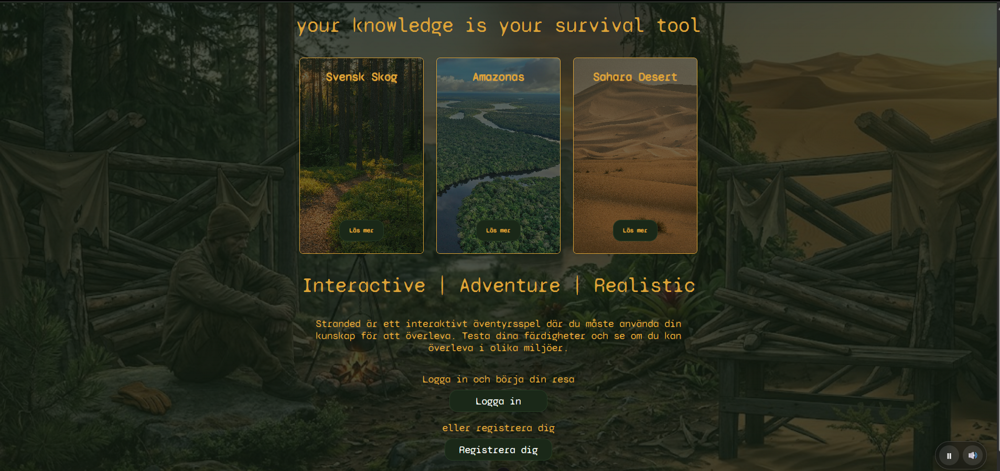

# 🏕️ Stranded

Stranded is a survival-themed quiz application created as a school project. The
purpose of the project is to combine an interactive quiz experience with user
accounts, progression, and statistics.



## ✨ Concept

The application is built around three environments:

- 🌲 Swedish forest
- 🌴 Amazonas
- 🏜️ Sahara

Users answer questions to progress through the levels. Completed levels,
correct and incorrect answers, and the user's current position are stored and
shown in the dashboard.

## 🛠️ Technologies

### 💻 Frontend

- **Vue 3** for the user interface and component-based development
- **Vite** as the frontend build tool
- **Vue Router** for page navigation and protected routes
- **CSS** for responsive layouts, themes, backgrounds, and quiz states
- **vue3-google-login** for Google authentication
- **canvas-confetti** for the quiz completion effect

### ⚙️ Backend

- **Node.js** as the runtime
- **Express** for the REST API and routing
- **MySQL** for users, levels, questions, answers, and statistics
- **mysql2** for database communication
- **JWT** for authenticated sessions
- **bcryptjs** for password hashing
- **Google OAuth** for social login verification

### 🗄️ Database

The database stores:

- User accounts and profile information
- Quiz levels and environments
- Questions and answer options
- Correct and incorrect answers
- Current quiz progress
- Level completion
- Statistics history

## 🧩 How we built the project

The project is divided into a Vue frontend and an Express backend:

```text
frontend/
  Vue views and reusable components
  Vue Router configuration
  CSS assets and responsive layouts
  Sound and visual effects

backend/
  Express application
  API routes
  Controllers and services
  Authentication middleware
  MySQL connection
```

The frontend communicates with the backend through HTTP requests. The backend
handles validation, authentication, quiz logic, and database operations. This
separation makes it possible to keep the user interface and application logic
independent from each other.

## 🔐 Authentication

The application supports two ways to authenticate:

- Regular registration and login with an email and password
- Login with a Google account

Passwords are hashed before they are stored. After a successful login, the
backend creates a JWT that is used when accessing protected user, quiz, and
statistics functionality.

## 📊 Quiz and progression system

The quiz is divided into levels. A user can:

1. Select an available level
2. Answer questions one at a time
3. Receive immediate feedback
4. Continue from the current question
5. Unlock the next level after completing the previous one
6. Review statistics in the dashboard

The application also uses sound effects, background music, progress bars,
locked-level indicators, and confetti to make the experience more interactive.

## 🔗 API structure

The backend is organized into separate route groups:

| Area | Purpose |
| --- | --- |
| User routes | Registration, login, profile updates, and account deletion |
| Quiz routes | Levels, questions, answer validation, and quiz progression |
| Statistics routes | Submitted answers, level statistics, and statistics history |

Important endpoints include:

- `POST /api/register`
- `POST /api/login`
- `POST /api/login/google`
- `GET /api/levels`
- `GET /api/levels/:levelId/questions`
- `POST /api/answers/:answerId/submit`
- `GET /api/users/:userId/statistics/levels`
- `GET /api/users/:userId/statistics/log/`

## 🎨 Design and user experience

The visual design is inspired by survival and exploration:

- Dark green color palette
- Gold accent color
- Environment-specific background images
- Responsive dashboard and quiz layouts
- Reusable buttons, cards, badges, and progress indicators
- Ambient audio and feedback sounds

## 🗂️ Project structure

```text
backend/
  app.js
  controllers/
  middleware/
  routes/
  services/

frontend/
  src/
    components/
    views/
    router/
    Assets/
  public/

docker-compose.yml
```

## 👥 Project focus

This project demonstrates how we combined frontend development, backend
development, database design, authentication, API communication, responsive
CSS, and interactive user experience into one application.
